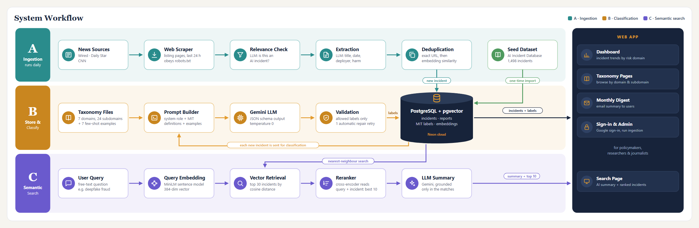

# AIRiskWatch

**An intelligence system for monitoring and analysis of AI incidents.**

AIRiskWatch is an intelligence system for monitoring and analysing AI incidents. As AI spreads into daily life, reports of its harms remain scattered across the web, unlabelled and hard to compare, leaving policymakers without the systematic evidence needed for governance. AIRiskWatch scrapes Wired, The Daily Star and CNN daily, uses an LLM to keep only genuine incidents, extracts structured details and removes duplicates. Each incident is classified with the MIT AI Risk Taxonomy, making patterns comparable. Users can explore trends on a dashboard, browse incidents by risk domain, search by meaning with AI-generated summaries, and receive a monthly email digest.

*Software Project Lab-3 · Institute of Information Technology, University of Dhaka*

## Motivation

- **AI incidents are growing.** AI now makes decisions in hiring, finance, healthcare, media and policing, and its failures reach real people.
- **The evidence is scattered.** Incidents are reported across thousands of news articles, written differently and rarely labelled, so they can't be counted or compared.
- **Governance needs data.** The *International AI Safety Report 2026* names the lack of systematic incident data as a key barrier to AI governance, leaving policymakers with an "evidence dilemma".

AIRiskWatch turns that scattered news into a structured, classified and searchable incident database, labelled with the [MIT AI Risk Taxonomy](https://airisk.mit.edu/) (7 domains, 24 subdomains, and causal labels for entity, intent and timing).

## System Workflow



Three pipelines share one PostgreSQL + pgvector database:

- **A · Ingestion (daily):** scrapes news listing pages, keeps articles from the last 24 hours, asks an LLM whether each one reports an AI incident, extracts structured fields and removes duplicates by URL and embedding similarity. The database is seeded once from the [AI Incident Database](https://incidentdatabase.ai/).
- **B · Classification:** each new incident is sent to Gemini with the MIT taxonomy definitions and few-shot examples. A JSON schema restricts the output to valid labels, and validation retries once on errors before the labels are saved.
- **C · Semantic search:** the query is embedded with MiniLM, the 30 nearest incidents are retrieved from pgvector, a cross-encoder reranks them to the best 10, and an LLM writes a summary grounded only in those matches.

The web app serves a trend dashboard, taxonomy pages, semantic search, a monthly email digest, Google or email sign-in, and an admin panel.

## Tech Stack

| Layer | Technologies |
|---|---|
| Frontend | React, TypeScript, Vite, TanStack Query |
| Backend | Python, FastAPI, SQLAlchemy, APScheduler |
| Database | PostgreSQL + pgvector (hosted on Neon) |
| LLM | Google Gemini 3.5 Flash-Lite (in use); GPT-OSS 120B and Qwen 3.8 27B via GroqCloud (compared) |
| Embeddings | `multi-qa-MiniLM-L6-cos-v1` (sentence-transformers, 384 dimensions) |
| Reranker | `cross-encoder/ms-marco-MiniLM-L6-v2` |
| Data | AI Incident Database, MIT AI Risk Repository |

## Getting Started

### Prerequisites

- Python 3.11+
- Node.js 18+
- A PostgreSQL database with the `pgvector` extension, for example a free [Neon](https://neon.tech/) project
- A [Gemini API key](https://aistudio.google.com/app/apikey) for classification, ingestion and search summaries

### 1. Backend

All commands run from `backend/`.

```bash
python -m venv .venv
.venv\Scripts\activate            # Windows
# source .venv/bin/activate       # macOS / Linux
pip install -r requirements.txt
cp .env.example .env
```

In `backend/.env`, set at least:

| Variable | Value |
|---|---|
| `DATABASE_URL` | Your PostgreSQL connection string (Neon: use the direct endpoint, not `-pooler`) |
| `GEMINI_API_KEY` | Your Gemini API key |
| `JWT_SECRET` | Any long random string: `python -c "import secrets; print(secrets.token_urlsafe(32))"` |

Google sign-in (`GOOGLE_CLIENT_ID`), the digest email (`SMTP_*`) and Groq (`GROQ_API_KEY`) are optional. Each is described in `.env.example`.

### 2. Dataset

The database is seeded from a snapshot of the AI Incident Database, which is not included in this repository.

1. Download the latest snapshot from the [AIID snapshots page](https://incidentdatabase.ai/research/snapshots/).
2. Extract it into `backend/data/aiid-snapshot/`, so that folder directly contains `incidents.csv`, `reports.csv` and `classifications_MIT.csv`. If you use another location, update `SEED_DATA_DIR` in `.env`.

### 3. Database

```bash
psql "$DATABASE_URL" -f db/schema.sql     # or paste db/schema.sql into the Neon SQL editor
python scripts/apply_migrations.py        # idempotent
python scripts/import_seed.py             # load the AIID snapshot
python scripts/backfill_embeddings.py     # local model, no API key needed; safe to re-run
```

### 4. Run the API

```bash
uvicorn app.main:app --reload
python scripts/create_admin.py --email you@example.com   # optional: create an admin account
```

The API runs at `http://127.0.0.1:8000`, with interactive docs at `/docs`. The first start downloads the embedding and reranker models, which takes a few minutes.

### 5. Frontend

All commands run from `frontend/`.

```bash
cp .env.example .env      # VITE_API_BASE_URL=http://127.0.0.1:8000
npm install
npm run dev
```

Open `http://127.0.0.1:5173`.

### Optional: classification and ingestion

These use LLM quota.

```bash
python scripts/run_classification.py --mode backfill        # classify incidents that have no MIT labels
python scripts/run_ingestion.py --check-sources             # test the news sources; no LLM, no writes
python scripts/run_ingestion.py --dry-run                   # relevance verdicts only, no writes
python scripts/run_ingestion.py --source wired -v           # full run for one source
```

To run ingestion automatically every day, set `INGESTION_ENABLED=true` and run uvicorn with a single worker.

## Project Structure

```
AIRiskWatch/
├── backend/
│   ├── app/
│   │   ├── core/        # LLM, embedding, reranker and news clients, scrapers
│   │   ├── models/      # SQLAlchemy models
│   │   ├── prompts/     # LLM prompts, MIT taxonomy definitions, few-shot examples
│   │   ├── routes/      # FastAPI routers
│   │   ├── schemas/     # Pydantic request/response models
│   │   └── services/    # ingestion, classification, search, digest, auth
│   ├── db/              # schema.sql and migrations
│   ├── docs/            # backend conventions
│   └── scripts/         # seeding, migrations, classification, ingestion
├── frontend/
│   ├── src/             # React app: pages, components, hooks, services
│   └── docs/            # frontend conventions
└── docs/                # README assets
```

## Data Sources

- [AI Incident Database](https://incidentdatabase.ai/): seed incidents and reports
- [MIT AI Risk Repository](https://airisk.mit.edu/): the risk taxonomy used for classification
- Wired, The Daily Star and CNN: news sources for daily ingestion (scraped within `robots.txt` rules)
